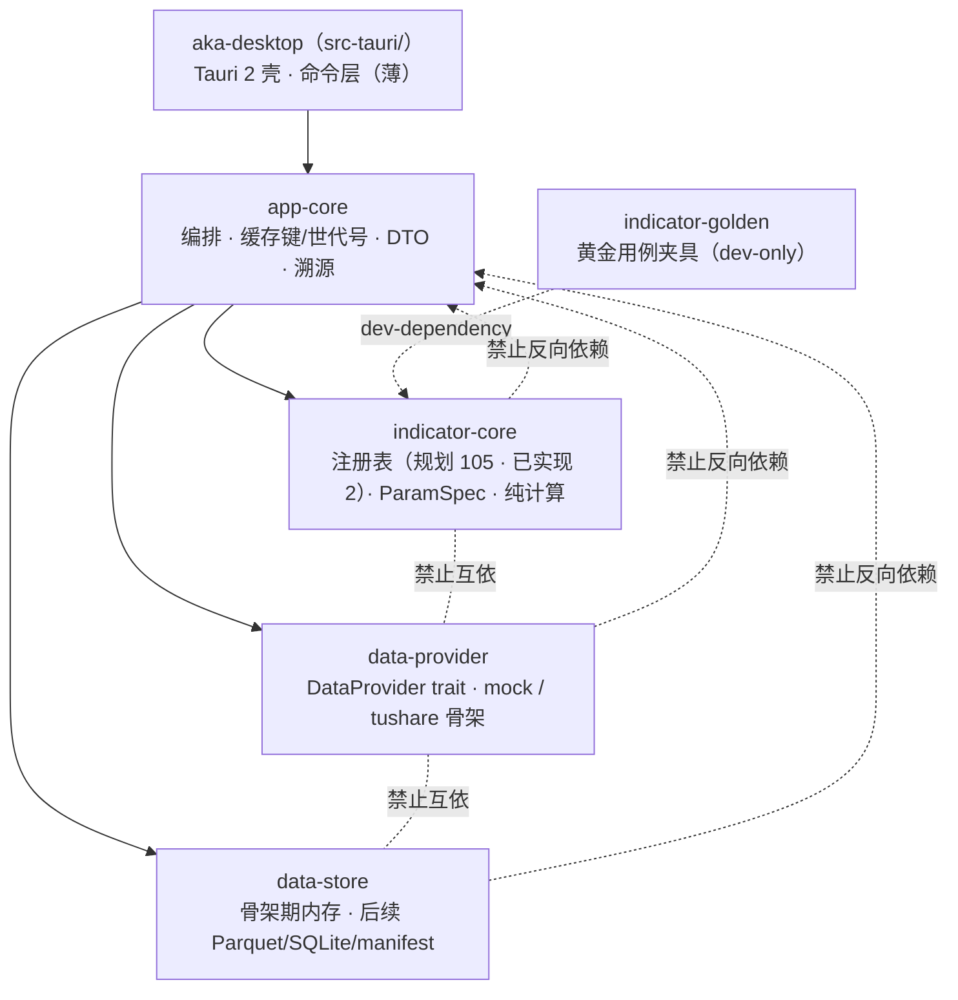
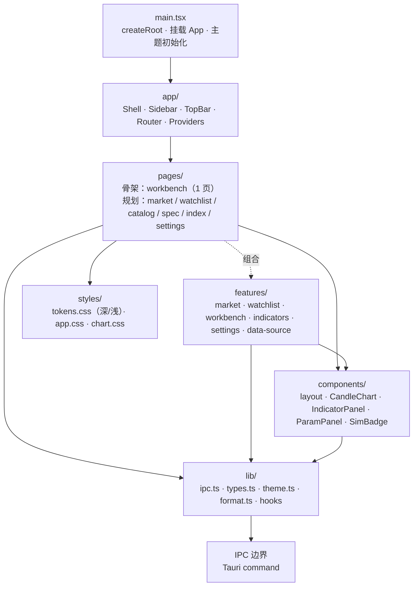
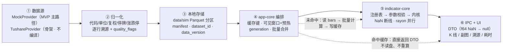

# AKA MVP · 模块架构图（crate / 前端 / IPC / 数据流）

> 版本 v1.0 · 2026-11-06 · 与 `app/` 骨架一一对应
> 配套阅读：[项目架构图](./aka-project-architecture.md) · HTML 版：`aka-module-architecture.html`

## 一句话结论

Rust 侧只有一条依赖链：**`aka-desktop → app-core → {indicator-core, data-provider, data-store}`**。三个底层 crate 互不依赖，也不认识 Tauri / Arrow 之外的上层。前端按「页面 → 特性 → 组件 → `lib/ipc`」单向引用，页面不直接拼命令字符串。所有跨层请求都必须经过 `lib/ipc.ts` 的类型化封装，错误码与 `generation` 在同一处处理。

> **设计取舍**：把 v3 中的 `tauri-app/` 与 `crates/desktop/` 合并为一个 `aka-desktop`（`src-tauri/`），命令层保持「薄」——只做反序列化、错误映射与状态注入；编排、缓存、DTO 全在 `app-core`，这样未来换壳（CLI / 服务端）不需要重写业务。

## 1. Rust workspace：crate 划分与依赖方向



**读图**：所有实线箭头都是「上层 → 下层」；红色虚线（图中以 `禁止` 标注）是从下层指回上层的禁止路径，以及三个平级 crate 之间的互依禁止。这套边集合会被 CI 用 `cargo metadata` 断言，而不是靠口头约定。

### crate 职责与允许依赖

| crate | 路径 | 职责 | 允许依赖 | 明确不依赖 |
|---|---|---|---|---|
| **aka-desktop** | `src-tauri/` | Tauri 2 壳、窗口/菜单、命令注册、`State<AppCore>`、错误映射 | `app-core`、`tauri`、`serde` | 不直接依赖三个底层 crate；不写业务规则 |
| **app-core** | `crates/app-core/` | 查询编排、批量合并、缓存键/世代号、复权归一、DTO、溯源装配 | `indicator-core`、`data-provider`、`data-store` | 不依赖 `tauri`；不直接读写 Parquet/SQLite 细节 |
| **indicator-core** | `crates/indicator-core/` | 指标注册表（规划 105 id，骨架实现 MA/MACD）、`ParamSpec` 校验、纯数值内核、NaN 语义 | 仅 `serde`（可选，用于注册表导出） | 不依赖 tokio / tauri / arrow / provider / store |
| **data-provider** | `crates/data-provider/` | `DataProvider` trait、mock 生成、tushare 解析骨架、归一化、能力协商 | `async-trait`、`serde`、`thiserror` | 不依赖 store / 指标 / app-core / tauri |
| **data-store** | `crates/data-store/` | 骨架期：`Candle` 模型 + 进程内 `CandleStore`；后续：Parquet 分区、SQLite 元数据、manifest / data_version | 骨架期无外部依赖；后续 `serde`、`thiserror`、`arrow`/`parquet`/`rusqlite` | 不依赖 provider / 指标 / app-core / tauri |
| **indicator-golden** | `crates/indicator-golden/` | 黄金用例夹具加载与容差断言 | `indicator-core`（dev-dependency） | 不进 release；不被 app-core 依赖 |

> **唯一例外说明**：`indicator-golden` 在测试配置中依赖 `indicator-core`，方向仍是「测试 → 被测」，不是反向依赖；它不会被 `aka-desktop` 或 `app-core` 引用。

## 2. 前端模块划分



**引用规则**

- `main → app → pages / features → components → lib`；页面不直接拼命令名。
- `components/` 只做展示：不 `invoke`、不含业务规则。
- `lib/ipc.ts` 是前端唯一出口：`invoke<T>` 类型化封装、`AppError` 错误码映射、`generation` 丢弃旧结果、NaN(null) 安全读取。
- 主题只切 `data-theme` 与语义色变量（`--up` / `--down`），不重绘组件；红涨绿跌切换同时影响图表与数值色。

**渲染与状态规则**

- 参数改动：本地 150ms 防抖 → 只对受影响实例发一次批量 `calc_indicators`（同 id 同参去重）。
- 缩放 / 平移 / 十字光标：只读已取回的数据与前端缓存，不发 IPC；窗口扩大时才按需补取。
- `generation`：每次请求 +1，旧响应到达时直接丢弃，避免快速切周期出现旧线覆盖新线。
- 模拟标识：全局状态条 + 页面头 + 报价头 + 渠道徽标，由 dataset manifest 驱动，不可关闭。

## 3. 端到端数据流（mock / 真实 provider → 存储 → 计算 → UI）



**四条硬规则**

1. 计算只发生在 `app-core` 的「未命中」分支；UI 不持有任何指标公式。
2. 同一 `(标的, 周期, 复权)` 的 bars 在一次批量请求内只读一次；多个指标共享同一借用视图。
3. 指标实例参数只在当前会话生效（D-14）：重启回注册表默认值；持久化的是自选/收藏/设置。
4. `sim` / `real` 用不同 `dataset_id` 与目录，缓存键含 `dataset_id`；切换数据源必须让旧缓存整体失效。

## 4. IPC 命令清单

骨架期 `src-tauri/src/commands.rs` 只注册了 **4 条**命令；下表其余命令是接口规划，尚未接线（前端不调用、Rust 未注册），不要按「已实现」理解。

| 命令 | 请求 | 响应 | 错误码 | 骨架状态 |
|---|---|---|---|---|
| `list_securities` | `{ market?, limit? }` | `SecurityDto[]`（code / name / market / board / isIndex / basePrice） | — | 已实现（mock 全量，120 只） |
| `get_bars` | `{ security, timeframe: "D", adj: "none"\|"qfq"\|"hfq", from?, to? }`（`from`/`to` 为**数组下标**，含端点） | `BarsResponse { security, timeframe, adj, datasetId, totalBars, bars: BarDto[], provenance }` | `UNKNOWN_SECURITY` / `INVALID_ARGUMENT` | 已实现（仅 D / mock） |
| `indicator_registry` | `RegistryRequest { category? }` | `RegistryResponse { plannedCount, implementedCount, indicators: IndicatorMetaDto[] }` | — | 已实现（2 个示例） |
| `calc_indicators` | `CalcRequest { security, timeframe, adj, from?, to?, generation, instances: InstanceRequest[] }` | `CalcResponse { generation, datasetId, engineVersion, computedMs, cacheHit, barCount, series: SeriesDto[] }` | `PARAM_OUT_OF_RANGE` / `UNKNOWN_INDICATOR` / `INSUFFICIENT_DATA` / `INVALID_ARGUMENT` | 已实现（MA / MACD） |
| `app_info` | 无 | `AppInfo { version, engineVersion, registryCount, platform, isFree }` | — | 规划（未注册） |
| `provider_status` | 无 | `ProviderStatus { active, providers: ProviderCard[], networkEnabled: false }` | — | 规划（未注册） |
| `dataset_manifest` | 无 | `ManifestDto { datasetId, provider, generatedAt, securityCount, barCount, from, to, seed, sim, sha256 }` | `DATASET_MISSING` | 规划（未注册） |
| `indicator_spec` | `{ id }` | `IndicatorSpecDto`（口径页四段 + 版本 + 黄金用例摘要） | `UNKNOWN_INDICATOR` | 规划（未注册） |
| `load_state` | `{ scope }` | `AppStateDto`（settings / watchlist / favorites） | `STATE_READ_FAILED` | 规划（未注册） |
| `save_state` | `{ scope, patch }` | `{ ok: true }` | `STATE_WRITE_FAILED` | 规划（未注册） |
| `quality_report` | `{ datasetId? }` | `QualityReportDto`（6 项检查 / 标记 / 过期） | `DATASET_MISSING` | 规划（未注册） |
| `export_diagnostics` | `{ includeLogs: bool }` | `{ path, bytes, excluded: string[] }` | `EXPORT_FAILED` | 规划（未注册） |
| `rebuild_dataset` | `{ seed, securityCount }` | `ManifestDto` | `REBUILD_FAILED` | 规划（未注册） |

> 骨架期 `get_bars` 与 `calc_indicators` 的 `from`/`to` 是**序列下标**（不是 epoch 日期）；这是为了让样例数据切片不依赖交易日历。接入真实 provider 时改为日期区间，DTO 同步调整。

**约定**：字段全部 `camelCase`；时间戳为 epoch 秒；价格/量/额为 `f64`；NaN 在 DTO 边界转 `null`，前端不得把 `null` 当 0 渲染。

## 5. 关键接口契约

### 5.1 DataProvider（`crates/data-provider/src/provider.rs`，与代码逐行一致）

```rust
// 4 必需 + 4 可选 + 2 运维；可选能力必须先看 capabilities() 再调用
#[async_trait]
pub trait DataProvider: Send + Sync {
    fn id(&self) -> ProviderId;                    // Mock | Tushare | Baostock | Akshare
    fn capabilities(&self) -> Capabilities;

    async fn securities(&self, as_of: Date) -> Result<SecurityMaster, ProviderError>;
    async fn trading_calendar(&self, from: Date, to: Date) -> Result<Vec<Date>, ProviderError>;
    async fn daily_bars(&self, req: BarRequest) -> Result<BarBatch, ProviderError>;
    async fn adjust_factors(&self, security: &str) -> Result<FactorBatch, ProviderError>;

    async fn index_members(&self, index: &str, as_of: Date) -> Result<Vec<String>, NotSupported>;
    async fn industry(&self, as_of: Date) -> Result<Vec<(String, String)>, NotSupported>;
    async fn limit_flags(&self, req: BarRequest) -> Result<Vec<BarRow>, NotSupported>;
    async fn minute_bars(&self, req: BarRequest) -> Result<BarBatch, NotSupported>;

    fn rate_policy(&self) -> RatePolicy;             // 契约，不是可选
    async fn health(&self) -> Health;                // 可达性 + 最近错误 + 配额
}
```

### 5.2 指标注册表与 ParamSpec（`crates/indicator-core/`）

```rust
pub enum ParamSpec {
    Int   { key: &'static str, label: &'static str, min: i64, max: i64, default: i64, step: i64 },
    Float { key: &'static str, label: &'static str, min: f64, max: f64, default: f64, step: f64, unit: Option<&'static str> },
    Enum  { key: &'static str, label: &'static str, variants: &'static [&'static str], default: &'static str },
    Bool  { key: &'static str, label: &'static str, default: bool },
}

pub struct Meta {
    pub id: &'static str,              // "ma" / "macd"
    pub name_zh: &'static str,
    pub name_en: &'static str,
    pub category: Category,            // Trend/Momentum/Volatility/Volume/Stat/Breadth
    pub params: &'static [ParamSpec],
    pub outputs: &'static [OutputSpec],
    pub inputs: InputReq,
    pub spec_status: SpecStatus,       // ManualComplete / Partial / ProductDefined
    pub engine_version: u16,           // 公式变更 +1，进缓存 key
    pub warmup: fn(&Params) -> usize,  // 与参数相关的纯函数
}

pub trait Indicator: Send + Sync {
    fn meta(&self) -> &'static Meta;
    fn calc(&self, view: &OhlcvView, params: &Params, out: &mut [Vec<f64>]) -> Result<(), CalcError>;
}

// 静态注册表；目录行数由已实现注册表派生，绝不硬编码 105
pub fn all() -> &'static [&'static dyn Indicator];
pub fn lookup(id: &str) -> Option<&'static dyn Indicator>;
```

### 5.3 IPC 请求 / 响应（TS ↔ Rust）

```ts
// 前端：@tauri-apps/api/core invoke
await invoke<CalcResponse>("calc_indicators", {
  req: {
    security: "600519.SH", timeframe: "D", adj: "qfq",
    from: 0, to: 399, generation: 7,
    instances: [
      { instanceId: "main-ma", indicatorId: "ma", params: { period: 20, maType: "sma" } },
      { instanceId: "sub-macd", indicatorId: "macd", params: { fast: 12, slow: 26, signal: 9 } }
    ]
  }
});

// 统一错误（Rust serde → TS）
// { code: "PARAM_OUT_OF_RANGE", message: "参数 period 超出范围",
//   retryable: false, details: { indicatorId: "ma", field: "period" } }
```

> **单一事实来源**：参数范围、默认值、步长只写在 Rust 注册表。`indicator_registry` 把 `ParamSpec` 原样序列化给前端，前端据此渲染控件；`calc_indicators` 用同一份规格校验。前端不复制一份限制，避免「前端 2~200、后端崩在 0」。

## 6. 骨架目录映射

```text
app/
├─ Cargo.toml                     # workspace：6 个成员
├─ package.json  vite.config.ts  tsconfig.json  index.html
├─ src/                           # 前端（React 18 + TS）
│  ├─ main.tsx  App.tsx
│  ├─ app/AppShell.tsx            # 左侧 rail + 可用页导航（其余入口 disabled）
│  ├─ pages/workbench/            # 骨架唯一页面：最小工作台
│  ├─ features/workbench/model.ts # 参数模型 / 实例组装 / 本地预校验
│  ├─ components/                 # CandleChart / Watchlist / ParamPanel / SimBadge
│  ├─ lib/ipc.ts  types.ts  theme.ts  format.ts
│  └─ styles/tokens.css  app.css
├─ src-tauri/                     # aka-desktop：Tauri 2 壳 + 命令层
│  ├─ Cargo.toml  build.rs  tauri.conf.json
│  ├─ capabilities/default.json
│  ├─ icons/                      # icon.png / icon.icns（构建必需）
│  └─ src/main.rs  lib.rs  commands.rs  state.rs
├─ crates/
│  ├─ app-core/                   # 编排、缓存、DTO、错误
│  ├─ indicator-core/             # 注册表 + MA / MACD + 单测
│  ├─ indicator-golden/           # 夹具加载骨架（dev-only）
│  ├─ data-provider/              # trait + mock + tushare 骨架
│  └─ data-store/                 # Candle 模型 + 内存缓存骨架
└─ README.md
```

**骨架范围**：只打通「一个页面 + 一个 mock provider + MA/MACD 两个指标 + 一条 IPC 链路」。mock 数据在进程内生成，骨架期**不落盘**（无 `data/` 目录、无 Parquet、无 SQLite）；其余页面、持久化存储、105 个指标、tushare 传输层均为后续 Sprint，代码中以 `TODO(sprint-*)` 标注，不伪造实现。

## 7. 依赖守卫与评审清单

### 自动化守卫

- `cargo metadata` 提取每个 crate 的依赖出边，白名单外即失败。
- `cargo check --workspace` + `cargo test -p indicator-core`（MA/MACD 单测）。
- 前端 `tsc --noEmit` + `vite build`；IPC 类型与 Rust DTO 字段名对齐（camelCase）。
- 注册表计数由 `all().len()` 派生；CI 断言「目录行数 = 已实现数」。

### 人工评审三问

1. 这个改动是否让底层 crate 认识了 Tauri / SQLite / provider？如果是，停。
2. 新命令是否只是「反序列化 + 调 app-core + 错误映射」？如果超过 15 行，业务应下沉。
3. 新指标是否只加在 `indicator-core` 并注册 Meta？如果改了 app-core 分支，说明抽象漏了。
