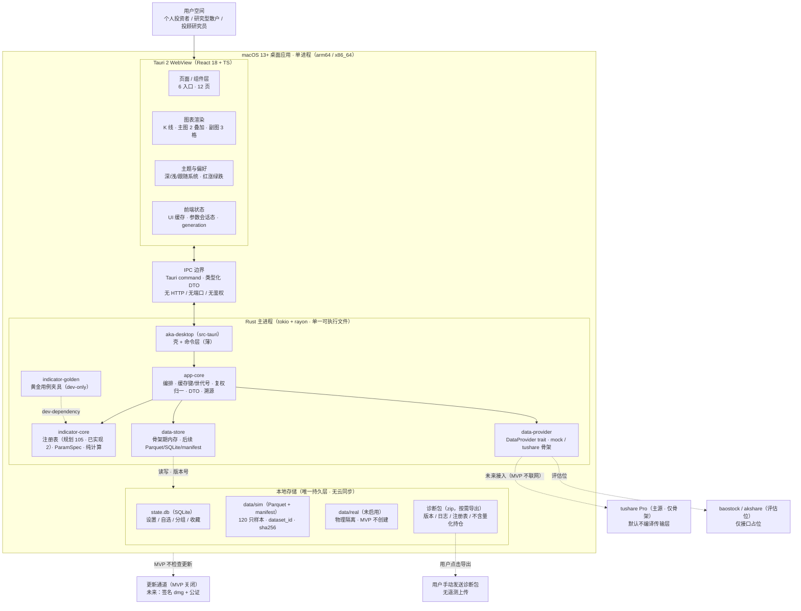

# AKA MVP · 项目架构图（系统上下文与部署视角）

> 版本 v1.0 · 2026-11-06 · 依据 `docs/prd/aka-prd-v0.1.md` 与 `architecture-report-mvp-v3.html`
> 配套阅读：[模块架构图](./aka-module-architecture.md) · HTML 版：`aka-project-architecture.html`

## 一句话结论

AKA 是一个**单进程、双宿主（WebView UI + Rust 计算）**的 macOS 应用：UI 与计算之间只有一条类型化的 Tauri IPC 边界；数据只落在本机 `state.db` 与 `data/sim`；MVP 不发起任何网络请求，外部数据源与更新通道只是**预留边界**，诊断包是唯一会离开本机的产物，且由用户手动导出。

> **骨架期差异**：首版骨架的 mock 行情在进程内生成并只保存在内存 `CandleStore`，尚未创建 `state.db` / `data/sim`；持久化存储（Parquet + SQLite）按本图规划在后续 Sprint 落地。

**部署红线**：没有 Python、没有 sidecar、没有本地 HTTP 端口、没有云端账号体系。安装包即全部运行时；断网可完成「首装 → 行情 → 工作台 → 指标改参」全链路。

## 系统上下文（Mermaid）

**读图**：整个应用只有一个进程边界。UI 只通过狭长的 Tauri IPC 条与 Rust 通信；Rust 侧的 `app-core` 是唯一的编排者，向下只依赖三个平级 crate。右侧的 tushare、更新通道、诊断包是**已定义但默认关闭**的外部边界，MVP 中不会产生任何网络请求。

## 部署单元与运行时职责

| 部署单元 | 形态 | 职责 | MVP 边界 |
|---|---|---|---|
| **AKA.app** | 单个 macOS 应用包（arm64 + x86_64） | WebView 宿主、Rust 主进程、本地数据目录、菜单与窗口 | 签名 + 公证后分发；无 helper / 无 sidecar / 无 XPC 服务 |
| **WebView 运行时** | 系统 WKWebView（Tauri 2 内置） | 12 个页面、图表渲染、主题、交互状态 | 不加载任何外网资源；字体与图标全部本地 |
| **Rust 主进程** | 应用包内单一可执行文件 | IPC 命令、查询编排、指标计算、数据归一化、存储访问 | 指标计算在主进程内完成，不 fork、不起服务 |
| **本地数据目录** | `~/Library/Application Support/aka/` | `state.db`、`data/sim`、`data/real`（未启用）、日志、诊断包 | 无云同步；sim 与 real 物理隔离子目录 |
| **外部数据源** | tushare / baostock / akshare | 真实行情接入（后续 Sprint） | MVP 仅保留 trait 与 tushare 解析骨架，传输层不编译 |
| **更新通道** | 签名 dmg + 更新清单 | 版本分发与升级 | MVP 关闭，不检查更新；后续再引入签名校验 |
| **诊断包** | 本地 zip，用户手动导出 | 排障与反馈 | 唯一会离开本机的产物；不含行情原始数据与自选代码 |

## 上下文边界与不可变约束

### 进程内边界

- **UI ↔ Rust**：只有 Tauri IPC；命令名与请求/响应形状见模块架构图第 4 节。
- **app-core ↔ 计算**：`indicator-core` 只吃切片，不认识 Arrow、tokio、SQLite、provider。
- **app-core ↔ 数据**：`data-provider` 产出源模型，`data-store` 只存归一化后的列式数据；两者互不依赖。
- **反向依赖禁止**：`indicator-core` / `data-provider` / `data-store` 不得依赖 `app-core` 或 `aka-desktop`。

### 进程外边界

- **外部数据源**：MVP 不联网；tushare 只保留请求构造与响应解析，传输层由 `feature = "live-tushare"` 控制。
- **更新通道**：MVP 不检查更新；未来采用签名 dmg + 公证，更新前校验签名与版本单调。
- **诊断包**：本地生成、用户手动发送；排除行情原始数据、自选代码、持仓成本。
- **无云控制面**：无账户、无登录、无支付、无订阅、无遥测上传。

> **范围守门**：任何「云同步、账户、支付、自动更新、实时行情」需求都必须先改 PRD 的冻结决策（D-02 / D-09 / D-10），不能在实现阶段悄悄塞进架构。

## 关键验收口径（架构层）

1. 单进程：UI 在 WebView，Rust 侧 tokio 接命令、rayon 并行批量指标。
2. 指标按需计算：可见窗口 + 预热前缀，不预计算全市场全指标。
3. 缓存键 = 标的 + 周期 + 复权 + 指标 + 参数 + `data_version` + 窗口。
4. 参数变更只重算受影响实例；旧 `generation` 结果一律丢弃。
5. 每根 K 线携带 `provider` / `dataset_id` / `quality_flags` / `adj_mode`。
6. NaN 不补零、不前向填充；指标线在 NaN 处断开。
7. 105 个指标 id；v0.1 发布门槛 P0 84 个可用、可改参、有口径页。
